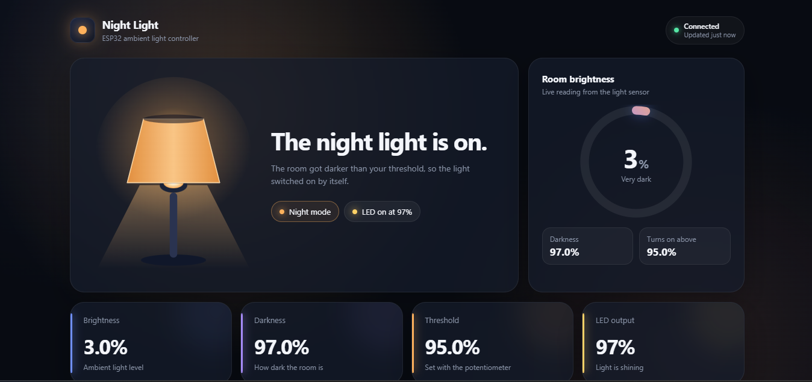

# Light Monitoring System

An automatic night light built on an ESP32. A light sensor watches the room, a potentiometer sets how dark is "dark enough", and a warm RGB LED switches on by itself. The ESP32 also hosts a live dashboard you can open from any phone or computer on your Wi-Fi.



## Features

- **Automatic lighting.** The light turns on when the room gets darker than your threshold and off again when it brightens.
- **Physical control.** A potentiometer sets the threshold, with no app needed.
- **No flicker.** A 3% hysteresis band stops the light bouncing on and off near the threshold.
- **Adaptive output.** The darker the room, the brighter the warm light, but never fully invisible.
- **Live dashboard.** An animated lamp, brightness ring, history chart and connection status, served straight from the ESP32.
- **Works offline.** The dashboard has no external fonts, scripts or images, so no internet connection is needed.

## How it works

```
Light sensor ─┐
              ├─► ESP32 ─► day/night decision ─► warm RGB LED
Potentiometer ┘      │
                     └─► Wi-Fi ─► dashboard in your browser (polls /api twice a second)
```

Full details are in [docs/how-it-works.md](docs/how-it-works.md).

## Hardware

| Part | Purpose |
|---|---|
| ESP32 dev board | Controller and web server |
| Light sensor (LDR) with resistor | Measures room brightness |
| Potentiometer | Sets the darkness threshold |
| RGB LED with resistors | The night light |

The pin table, wiring notes and parts list are in [hardware/](hardware/README.md).


## Getting started

### Requirements

- Arduino IDE 2.x
- ESP32 board package for the Arduino IDE, version **3.0 or newer** (the firmware uses `analogWrite()`)
- A 2.4 GHz Wi-Fi network (the ESP32 does not support 5 GHz)

### Steps

1. **Clone the repo**
   ```bash
   git clone https://github.com/victor-essien/light-monitoring-system.git
   ```
2. **Add your Wi-Fi details.** In `firmware/night_light/`, copy `secrets.example.h` to `secrets.h` and fill in your network name and password. `secrets.h` is git-ignored.
3. **Open the sketch.** Open `firmware/night_light/night_light.ino` in the Arduino IDE.
4. **Select your board.** Choose *ESP32 Dev Module* (or your board) and the right COM port.
5. **Upload.** If the upload stops partway, see [docs/troubleshooting.md](docs/troubleshooting.md).
6. **Find the address.** Open the Serial Monitor at **115200 baud**. After "Wi-Fi connected!" it prints an address like `http://192.168.1.50`.
7. **Open the dashboard.** Visit that address from a device on the same network.

### Calibrate the light sensor

Every LDR circuit reads slightly differently. The firmware ships with values measured on the original build (bright ≈ 87, dark ≈ 4095). To measure your own, follow [docs/calibration.md](docs/calibration.md).

## Project structure

```
esp32-night-light/
├── firmware/night_light/
│   ├── night_light.ino        # setup() and loop() only
│   ├── secrets.example.h      # template for Wi-Fi details
│   └── src/
│       ├── config.h           # pins, calibration, timing
│       ├── state.h / .cpp     # shared system state
│       ├── sensors.h / .cpp   # ADC reading and conversion
│       ├── light_control.h / .cpp  # day/night logic and RGB output
│       ├── wifi_manager.h / .cpp   # Wi-Fi connection
│       ├── web_server.h / .cpp     # routes and JSON API
│       └── web/dashboard.h    # the dashboard page (HTML, CSS, JS)
├── hardware/                  # schematic, pin table, parts list
└── docs/                      # guides and screenshots
```

## Documentation

- [How it works](docs/how-it-works.md)
- [API reference](docs/api.md)
- [Calibration](docs/calibration.md)
- [Troubleshooting](docs/troubleshooting.md)

## Ideas for next steps

- Manual override from the dashboard (needs a new firmware endpoint)
- A friendly address such as `nightlight.local` using mDNS
- Saving calibration values in flash so they survive a re-flash
- Over-the-air firmware updates

## License

MIT. See [LICENSE](LICENSE).
