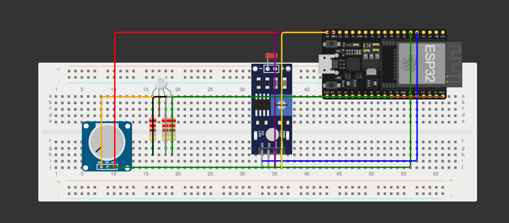

# Hardware

Add your schematic image as `hardware/schematic/schematic.png` (any format works, update the link above if you use a different name).

## Pin table

| Signal | ESP32 pin | Direction | Notes |
|---|---|---|---|
| Light sensor | GPIO 34 | Analog input | ADC1, input-only pin |
| Potentiometer wiper | GPIO 35 | Analog input | ADC1, input-only pin |
| LED red | GPIO 4 | PWM output | Through a series resistor |
| LED green | GPIO 5 | PWM output | Through a series resistor. GPIO 5 is a boot strapping pin |
| LED blue | GPIO 18 | PWM output | Through a series resistor |

These match `src/config.h`. Change them in one place if you rewire.

## What the firmware assumes about the wiring

These points are inferred from the code, so check them against your schematic.

- **Light sensor divider.** The code treats a **higher reading as darker** (dark ≈ 4095, bright ≈ 87). With an LDR, that means the **fixed resistor is on the 3.3 V side** and the **LDR is between the sensor pin and GND**. In the dark the LDR resistance rises, which pulls the pin voltage up.
- **Potentiometer.** The outer legs go to 3.3 V and GND, and the middle leg (wiper) goes to GPIO 35.
- **RGB LED type.** A higher PWM value gives a brighter light, which matches a **common-cathode** LED (common leg to GND). A common-anode LED would behave inverted.
- **Power.** Use **3.3 V** for the sensor and potentiometer, never 5 V, because the ESP32's ADC pins are not 5 V tolerant.

## Wi-Fi and the ADC

The light sensor and potentiometer are on **ADC1** pins (GPIO 34 and 35). On the ESP32, ADC2 pins cannot be read while Wi-Fi is active, so keep analog inputs on ADC1.

## Parts list

See [bom.md](bom.md).
